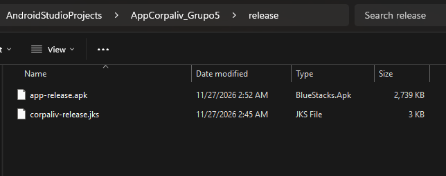

# 1. Nombre del Proyecto

**AppCorpaliv_Grupo5 — Red Alba Lab (Evaluación Parcial 4 · DSY1105)**

Aplicación móvil nativa para Android (Kotlin + Jetpack Compose + Material 3) conectada a un **microservicio REST propio en Spring Boot** (Kotlin + JPA + H2) y a la **API externa `mindicador.cl`**, orientada a modelar la difusión de programas sociales y gestión de solicitudes de colaboración de la red formativa Alba Lab / CORPALIV utilizando datos **100% ficticios** (`@ejemplo.cl`).

---

# 2. Integrantes y Planificación

- **Alexander Simpertigue** (`Alesimm`)
- **Joseph Rivas** (`josephR`)
- **Tablero Trello:** [AppCorpalivGrupo5](https://trello.com/b/5XeJlyhX/appcorpalivgrupo5)

---

# 3. Funcionalidades y Arquitectura Completa

### Arquitectura del sistema (MVVM + Offline-First + Microservicio)

```text
+-----------------------------------------------------------------------+
|                   APP ANDROID (Kotlin + Jetpack Compose)              |
|  - UI Material 3: Login, Home, Catalogo, Detalle, Contacto,           |
|    Resumen, Perfil (Cuenta), Estado (Ajustes) y AcercaDe              |
|  - Ilustraciones vectoriales en Canvas e iconos adaptativos           |
|  - Modo claro / oscuro dinamico y utilidades nativas (DIAL / SEND)    |
+-----------------------------------+-----------------------------------+
                                    | StateFlow / SharedFlow
                                    v
+-----------------------------------------------------------------------+
|                        CAPA VIEWMODEL (MVVM)                          |
|  - MainViewModel: eventos de navegacion en SharedFlow                 |
|  - UsuarioViewModel: login, formulario, CRUD y sincronizacion         |
|  - EstadoViewModel: tema oscuro, alertas y favoritos en DataStore     |
|  - IndicadoresViewModel: consulta de UF, UTM y Dolar                  |
+-------------------+-------------------------------+-------------------+
                    |                               |
                    v                               v
+-----------------------------------+   +-------------------------------+
|    PERSISTENCIA LOCAL (Phone)     |   |   CAPA REMOTA (Retrofit 2)    |
|  - Room SQLite v4 (SolicitudDao)  |   |  - SolicitudApiService (CRUD) |
|  - DataStore Preferences          |   |  - MindicadorApiService       |
|  - Validadores puros desacoplados |   +---------------+---------------+
+-----------------------------------+                   |
                                                        v
                     +----------------------------------+---------------+
                     |  MICROSERVICIO PROPIO (Spring Boot 4 + H2)       |
                     |  - CRUD /api/v1/solicitudes                      |
                     |  - Base de datos H2 persistente + Bean Validation|
                     +--------------------------------------------------+
```

### Funcionalidades principales
- **Autenticación y sesión segura:** Login con credenciales de prueba, validación desacoplada sin pistas de política de contraseña, recuperación simulada y opción *Recordarme* con DataStore.
- **Catálogo de programas sociales:** 3 programas ficticios (*Taller de Oficios*, *Inserción Laboral*, *Transición a la Vida Adulta*) con ilustraciones vectoriales dibujadas en Canvas (`drawArc`, `Path`), detalle y favoritos persistentes.
- **Formulario de contacto y CRUD híbrido (Room + Spring Boot):**
  - Validación por campo en `Validadores.kt` (nombre, apellido, correo, colaboración, RUT comercial condicional y mensaje).
  - Envío en tiempo real al microservicio (`POST`, estado `RECIBIDA`) con respaldo automático offline en Room (`PENDIENTE SIN RED`).
  - Comprobante interactivo (`ResumenScreen`), edición (`PUT`), eliminación con diálogo de confirmación (`DELETE`) y sincronización segura protegida con `Mutex` al recuperar conexión.
- **API externa (`mindicador.cl`):** Tarjeta desplegable en Contacto que muestra **UF**, **UTM** y **Dólar** con recarga manual y tolerancia a fallos sin afectar el flujo del microservicio propio.
- **Pruebas automatizadas (90 pruebas en la app Android):**
  - `app/src/test/`: **78 pruebas unitarias** (JUnit 4, MockK, `kotlinx-coroutines-test`) para `Validadores`, `SolicitudDto`, `SolicitudRepository`, `MindicadorRepository`, `MainViewModel` e `IndicadoresViewModel`.
  - `app/src/androidTest/`: **12 pruebas de interfaz en Jetpack Compose** (`UiPantallasComposeTest`).

### Estructura del monorepo
```text
AppCorpaliv_Grupo5/
├── app/                              # Aplicacion Android (Kotlin + Compose + Room + Retrofit)
│   ├── build.gradle.kts              # Configuracion Gradle y firma release (.jks)
│   └── src/
│       ├── main/java/com/duoc/corpaliv/
│       │   ├── data/                 # AppDatabase, SolicitudDao, SolicitudEntity, Repositorios, DataStore
│       │   ├── model/                # ProgramaSocial, UsuarioUiState, UsuarioErrores
│       │   ├── navigation/           # AppNavigation, NavigationEvent, Screen
│       │   ├── remote/               # RetrofitClient, ApiServices y DTOs
│       │   ├── ui/                   # screens/, components/, theme/, utils/
│       │   ├── validation/           # Validadores.kt (reglas puras de negocio)
│       │   └── viewmodel/            # MainViewModel, UsuarioViewModel, EstadoViewModel, IndicadoresViewModel
│       ├── test/                     # 78 pruebas unitarias (JUnit 4 + MockK)
│       └── androidTest/              # 12 pruebas UI Jetpack Compose
├── microservicio-corpaliv/           # API REST Spring Boot (Kotlin + JPA + Validation + H2)
│   └── src/main/kotlin/com/duoc/corpaliv/api/
│       ├── controller/               # SolicitudController.kt (/api/v1/solicitudes)
│       ├── model/                    # Solicitud.kt (entidad JPA)
│       ├── repository/               # SolicitudRepository.kt (Spring Data JPA)
│       └── service/                  # SolicitudService.kt (logica CRUD y folios)
└── release/                          # APK firmado, llave .jks y captura de evidencia
```

---

# 4. Endpoints Utilizados (Microservicio y API Externa)

### Microservicio propio — Spring Boot (`http://10.0.2.2:8080/api/v1/solicitudes`)

| Método | Ruta | Descripción |
| :--- | :--- | :--- |
| `GET` | `/api/v1/solicitudes` | Lista todas las solicitudes almacenadas en H2 |
| `GET` | `/api/v1/solicitudes/{id}` | Obtiene el detalle de una solicitud por ID |
| `POST` | `/api/v1/solicitudes` | Crea una nueva solicitud, valida campos y genera folio (`201 Created`) |
| `PUT` | `/api/v1/solicitudes/{id}` | Actualiza colaboración, RUT comercial o mensaje (`200 OK`) |
| `DELETE` | `/api/v1/solicitudes/{id}` | Elimina una solicitud existente (`204 No Content`) |

### API externa — Indicadores económicos (`https://mindicador.cl/`)

| Método | Ruta | Descripción |
| :--- | :--- | :--- |
| `GET` | `/api` | Consulta valores diarios de UF, UTM, Dólar y fecha de referencia |

---

# 5. Pasos para Ejecutar

### Requisitos previos
- **Java 21 LTS** (definido en `gradle/gradle-daemon-jvm.properties`).
- **Android Studio** con SDK 24+ (Target SDK 37) y emulador o dispositivo físico.

### 1) Levantar el microservicio Spring Boot
```powershell
cd microservicio-corpaliv
.\mvnw.cmd spring-boot:run
```
- Puerto local: `http://localhost:8080` (desde el emulador Android se consume en `http://10.0.2.2:8080/api/v1/`).
- Consola web H2: `http://localhost:8080/h2-console` (JDBC URL: `jdbc:h2:file:./data/corpalivdb;AUTO_SERVER=TRUE`, usuario `sa`, contraseña vacía).

### 2) Ejecutar la aplicación Android
1. Abrir el proyecto en Android Studio y ejecutar `:app` en el emulador (o instalar `release/app-release.apk`).
2. Credenciales precargadas de prueba en Login:
   - **Correo:** `colaborador@ejemplo.cl`
   - **Contraseña:** `Alba2026!`

### 3) Ejecutar pruebas y compilar APK firmado
```powershell
# Pruebas unitarias Android (78 tests)
.\gradlew.bat :app:testDebugUnitTest

# Pruebas UI Compose (12 tests — requiere emulador activo)
.\gradlew.bat :app:connectedDebugAndroidTest

# Pruebas del microservicio Spring Boot
cd microservicio-corpaliv; .\mvnw.cmd test

# Generar APK firmado en modo release
.\gradlew.bat :app:assembleRelease
```

---

# 6. Captura del APK Firmado y `.jks`

- **Llave Keystore (`.jks`):** [`release/corpaliv-release.jks`](release/corpaliv-release.jks) (`alias: corpaliv_key`)
- **APK firmado (`release`):** [`release/app-release.apk`](release/app-release.apk)
- **Configuración Gradle:** [`app/build.gradle.kts`](app/build.gradle.kts) (`signingConfigs.release` enlazado a `buildTypes.release`)


